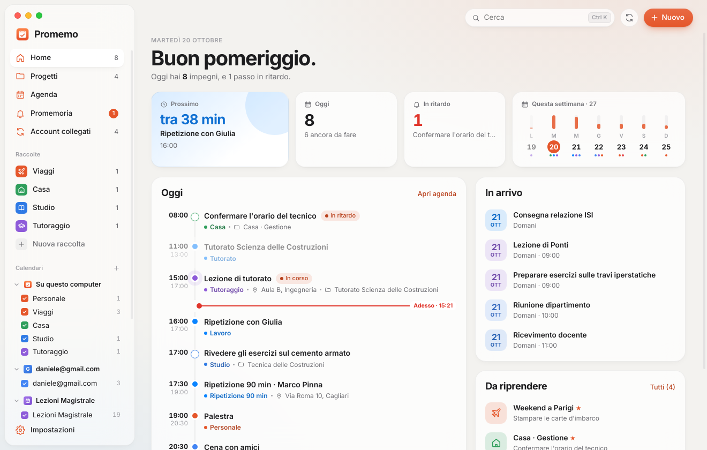
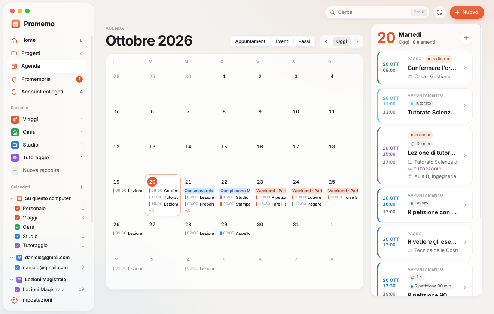
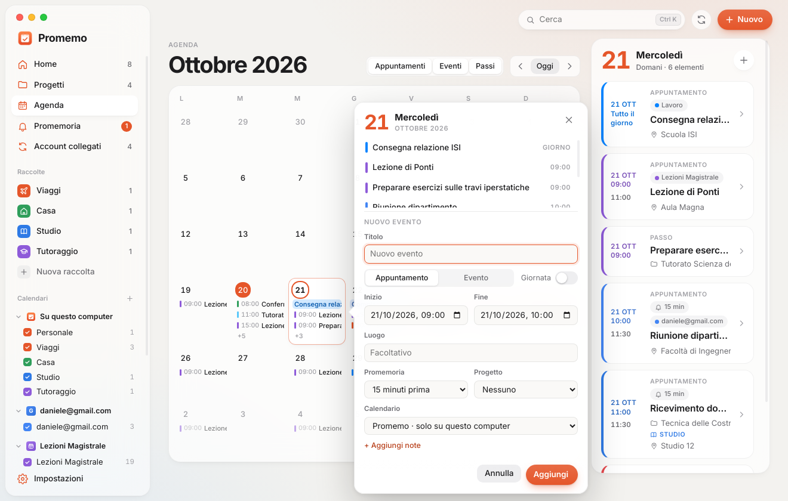
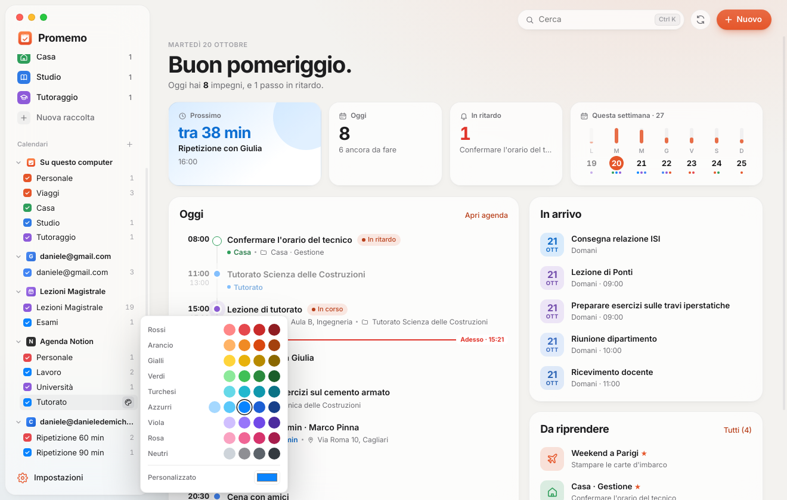

# Promemo

App desktop per Linux (Electron) per ricordare impegni e ciò che hai pianificato.
Stile ispirato a macOS, dati salvati sul tuo computer, sincronizzazione con Google Calendar, Notion e calendari .ics.



| Agenda | Popup del giorno | Colori |
|---|---|---|
|  |  |  |

## Sezioni
- **Home**: riepilogo a riquadri (prossimo impegno con conto alla rovescia, oggi, in ritardo, settimana), linea del tempo di oggi con l'indicatore “adesso”, in arrivo e progetti da riprendere.
- **Palette comandi** (Ctrl+K): cerca eventi e progetti, crea, naviga.
- **Progetti**: prossimo passo, passi con scadenza, appuntamenti collegati, timeline di tracce.
- **Agenda**: mese a tutta pagina con i titoli degli impegni nei giorni, colonna del giorno selezionato. **Un clic su un giorno apre il popup animato** con gli impegni del giorno e il modulo completo per un nuovo evento (titolo, tipo, giornata intera, inizio/fine, luogo, promemoria, progetto, calendario di destinazione, note).
- **Promemoria**: tutto ciò che ha un avviso, con notifiche desktop.
- **Account collegati**: Google Calendar, Notion, calendari da link.

## Calendari e colori
Nella barra laterale, sotto **Calendari**, ogni account mostra i suoi gruppi con un colore:
- **Su questo computer**: *Personale* e una voce per ogni raccolta (Viaggi, Casa, Studio…).
- **Google**: un gruppo per ogni calendario sincronizzato.
- **Notion**: un gruppo per ogni valore di una colonna *Seleziona*, *Selezione multipla* o *Stato* (es. `Area`: Personale, Lavoro, Università…). I colori di partenza sono quelli di Notion.
- **Calendari .ics**: un gruppo per calendario, più uno per ogni `CATEGORIES` presente.

Clic sul quadratino = mostra/nascondi. Icona tavolozza = scegli il colore: 9 famiglie con 4–5 sfumature (es. Personale in rosso, tutto il lavoro in varianti di azzurro) o un colore personalizzato. Schede, punti del calendario e popup usano il colore del gruppo.

## Sincronizzazione
| Servizio | Direzione | Cosa serve |
|---|---|---|
| Google Calendar (Gmail) | lettura e scrittura | un ID client OAuth di tipo *App desktop* (istruzioni nell'app) |
| Notion | lettura e scrittura | token di un'integrazione interna + database con una proprietà Data condiviso con l'integrazione |
| Calendly | sola lettura | un token di accesso personale (funziona anche con il piano gratuito) |
| Link .ics / webcal (iCloud, Outlook, Nextcloud, Proton, orari corsi…) | sola lettura | l'indirizzo iCal pubblico o segreto |

- **Calendly**: ogni prenotazione arriva con nome ed email di chi prenota, risposte al modulo, luogo o link della videochiamata e link per spostare/annullare. I tipi di appuntamento (es. *Ripetizione 60 min*) diventano gruppi colore. Le copie che Calendly scrive nel calendario Google collegato vengono nascoste per evitare doppioni (disattivabile).
- Avviene all'avvio, ogni 15 minuti, al risveglio del PC e con il pulsante ⟳ in alto.
- Gli eventi creati in Promemo possono andare su Google o Notion (campo *Calendario*); modifiche ed eliminazioni vengono inviate al servizio.
- Gli eventi importati restano collegabili a un progetto e possono avere un promemoria di Promemo.
- Finestra sincronizzata: da 60 giorni fa a circa 13 mesi avanti.
- Token e credenziali sono in `~/.config/Promemo/credenziali.bin`, cifrati con il portachiavi di sistema (GNOME Keyring/KWallet) quando disponibile.

## Avvio (sviluppo)
```bash
npm install
npm start
```

## Pacchetti
```bash
npm run dist        # dist/Promemo-1.3.0.AppImage e dist/trama_1.3.0_amd64.deb
sudo apt install ./dist/trama_1.3.0_amd64.deb
```

## Scorciatoie
Ctrl+K palette comandi · Ctrl+N nuovo · Ctrl+F cerca · Ctrl+1…5 sezioni · Esc chiude popup e finestre.

## Dati
`~/.config/Promemo/promemo.json` (scrittura atomica). Backup da *Impostazioni → Esporta*.

## Cambiare nome
```bash
node scripts/rinomina.js NuovoNome   # aggiorna nome, pacchetto, appId e cartella dati
npm run dist
```
Al primo avvio i dati vengono copiati dalla cartella del vecchio nome. Gli account collegati andranno ricollegati se il portachiavi di sistema lega le credenziali al nome dell'app.

## Struttura
```
main.js        processo principale: archivio, promemoria, vassoio, IPC
sync.js        Google Calendar (OAuth PKCE), Notion API, feed .ics; unione e invio modifiche
ics.js         parser iCalendar con fusi orari e ricorrenze
preload.js     ponte sicuro verso l'interfaccia
src/           interfaccia (HTML, CSS, JS senza framework)
scripts/       utilità (rinomina)
```

## Licenza
MIT
