# Promemo

App desktop per Linux (Electron) per ricordare impegni e ciò che hai pianificato.
Stile ispirato a macOS, dati salvati sul tuo computer, sincronizzazione con Google Calendar, Notion e calendari .ics.


| Agenda | Popup del giorno | Colori |
|---|---|---|
|  |  |  |

## Sezioni
- **Home**: riepilogo a riquadri (prossimo impegno con conto alla rovescia, oggi, in ritardo, settimana), linea del tempo di oggi con l'indicatore “adesso”, in arrivo e progetti da riprendere.
- **Palette comandi** (Ctrl+K): cerca eventi e progetti, crea, naviga.
- **Progetti**: prossimo passo, passi con scadenza, appuntamenti collegati, timeline di tracce.
- **Agenda**: viste **Giorno**, **Settimana** (come Notion Calendar: griglia oraria, riga “tutto il giorno”, impegni affiancati quando si sovrappongono, linea rossa dell'ora attuale, numero della settimana) e **Mese**. Trascina su una fascia vuota per creare un evento, trascina un evento per spostarlo (anche su un altro giorno), tira il bordo inferiore per cambiarne la durata. Mini calendario nella barra laterale. **Un clic su un giorno apre il popup animato** con gli impegni del giorno e il modulo completo per un nuovo evento (titolo, tipo, giornata intera, inizio/fine, luogo, promemoria, progetto, calendario di destinazione, note).
- **Promemoria**: tutto ciò che ha un avviso, con notifiche desktop.
- **Viaggi**: destinazioni e itinerari letti da Notion, con il racconto scritto dall'IA (vedi sotto).
- **Database Notion**: sfoglia e modifica i database condivisi con l'integrazione.
- **Account collegati**: Google Calendar, Notion, calendari da link.

## Assistente proattivo
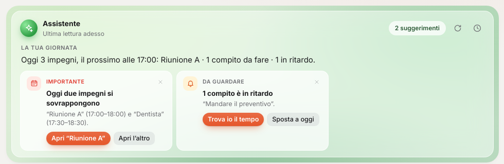

Promemo si comporta come un assistente personale anche quando non gli chiedi niente. Ogni 2 ore (si cambia in *Impostazioni → Assistente proattivo*), dopo ogni sincronizzazione e poco dopo ogni modifica legge agenda, compiti, viaggi, tempi di viaggio e calendari collegati, e in cima alla Home ti dice:
- **la tua giornata** in poche righe (se c'è un motore IA, la scrive l'IA con fino a 3 suggerimenti in più);
- **cosa ha notato**: impegni che si sovrappongono, quando uscire e trasferimenti impossibili, compiti in ritardo, scadenze senza un momento per lavorarci, lo spazio libero più lungo e il compito giusto per riempirlo, giornate troppo piene, partenze presto domani, viaggi in arrivo, account che non si sincronizzano;
- **le azioni con un clic**: sposta a oggi o a domani, trova io il tempo, fissa alle 15, avvia la concentrazione, promemoria per la valigia, apri l'evento. *Ignora* nasconde un suggerimento.

Le cose importanti arrivano anche come notifica (al massimo 6 al giorno, mai nelle ore di silenzio). L'orologio in alto a destra della card apre lo storico di **cosa ho notato**.

**Legge anche la posta** (Gmail, sola lettura): attiva *Leggi la posta* sull'account Google in *Account collegati*. Gli inviti di calendario vengono riconosciuti sempre; con un motore IA anche appuntamenti, convocazioni, prenotazioni e scadenze scritti nel testo delle email. Ogni cosa trovata arriva come suggerimento con *Aggiungi in agenda* (o *Aggiungi il compito*, per le scadenze) e *Apri la mail*; se è già in agenda non viene proposta. Serve abilitare la Gmail API e il permesso `gmail.readonly` nel tuo progetto Google Cloud (le istruzioni sono nella finestra di collegamento).

## Piano di studio
*Nuovo → Piano di studio* (o Ctrl+K “piano di studio”): esame, data e argomenti con le ore (“Travi iperstatiche — 6”). Promemo crea un progetto con le sessioni, le distribuisce fino all'esame nelle fasce e nei giorni che scegli, con un massimo di ore al giorno, aggiunge i **ripassi distanziati** (il giorno dopo, dopo 3 giorni e dopo una settimana) e negli ultimi giorni una simulazione e il ripasso generale. Le sessioni sono compiti pianificati da soli: se ne salti una o arriva un impegno, si spostano. Nel progetto vedi a che punto sei rispetto a dove dovresti essere e puoi cambiare ore al giorno, fascia e giorni; l'assistente ti avvisa se resti indietro e propone di aumentare le ore.

## Ripetizioni con Calendly
Gli slot fissi restano su Calendly, come prima: gli studenti scelgono l'orario da soli. Promemo legge i tuoi orari di disponibilità e ti avvisa quando un impegno che **Calendly non vede** (creato solo in Promemo, da Notion o da un calendario web) cade in uno slot, così puoi chiuderlo prima che qualcuno prenoti. Ogni prenotazione ha la **scheda dello studente**: lezioni fatte, prossima lezione, cosa ha scritto nella prenotazione, i tuoi appunti delle volte precedenti e un campo per gli appunti di questa lezione. Prima di una lezione l'assistente ti ricorda cosa avevate fatto l'ultima volta; dopo, ti chiede due righe su com'è andata. Se gli slot non si leggono, rigenera il token personale di Calendly con il permesso sulla disponibilità.


## Verifica in due passaggi
In *Impostazioni → Password*, con la password all'avvio attiva, *Verifica in due passaggi → Attiva*: inquadra il codice QR con un'app di autenticazione (Google Authenticator, Microsoft Authenticator, Aegis, 2FAS, Authy, Ente Auth, Proton Pass, Bitwarden, 1Password…) e scrivi il codice a 6 cifre. Da quel momento all'avvio, dopo la password, serve anche il codice dell'app. Ricevi 10 **codici di emergenza** (ognuno vale una volta) per quando non hai il telefono; la chiave di recupero resta la via d'emergenza e salta anche questo passaggio. La chiave segreta è cifrata con i tuoi dati: senza la password giusta non si può nemmeno controllare il codice.

## Sicurezza
Vedi [docs/SICUREZZA.md](docs/SICUREZZA.md): cosa protegge Promemo, come, e i test automatici (`npm test`) che lo verificano a ogni modifica.

## Password all'avvio
Promemo può chiedere una password a ogni apertura (*Impostazioni → Password all'avvio*, proposta anche al primo avvio).
- I dati (`promemo.enc`) e le credenziali degli account (`credenziali.enc`) vengono cifrati con **AES-256-GCM**; la chiave è derivata dalla password con **scrypt**. Le copie non cifrate vengono eliminate.
- All'attivazione viene mostrata una **chiave di recupero** (24 caratteri): sblocca i dati se dimentichi la password e chiede subito di sceglierne una nuova.
- Dopo 3 tentativi sbagliati l'attesa tra un tentativo e l'altro cresce fino a 60 secondi.
- Finché Promemo è bloccata non può inviare notifiche né sincronizzare: dopo lo sblocco resta attiva (anche nell'area di notifica) fino all'uscita.
- I backup esportati in JSON non sono cifrati.

## Pianificazione automatica
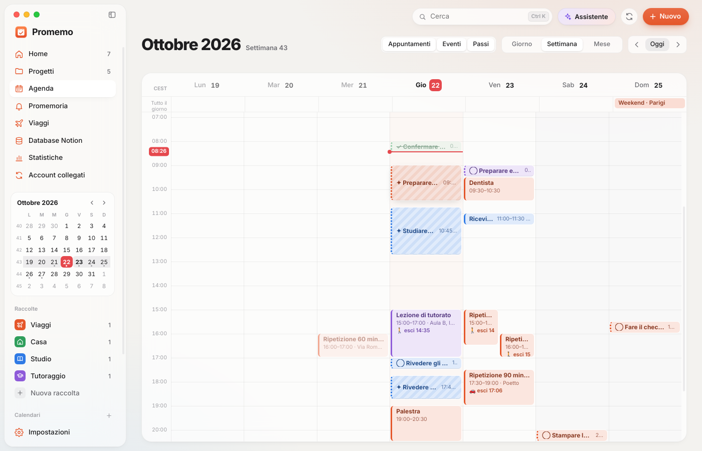

Nella scheda di un compito attiva **Pianifica Promemo** e indica entro quando va fatto e quanto dura: Promemo trova uno spazio libero nel tuo orario di lavoro (blocchi tratteggiati con ✦), rispettando impegni, pausa pranzo e un margine tra un'attività e l'altra. Se un impegno occupa quel posto, il compito si sposta da solo; se lo trascini tu, resta dove l'hai messo. Orario, giorni e margine in *Impostazioni → Calendario*.

## Scrivi una frase
| Nuovo | Da qualsiasi app |
|---|---|
| 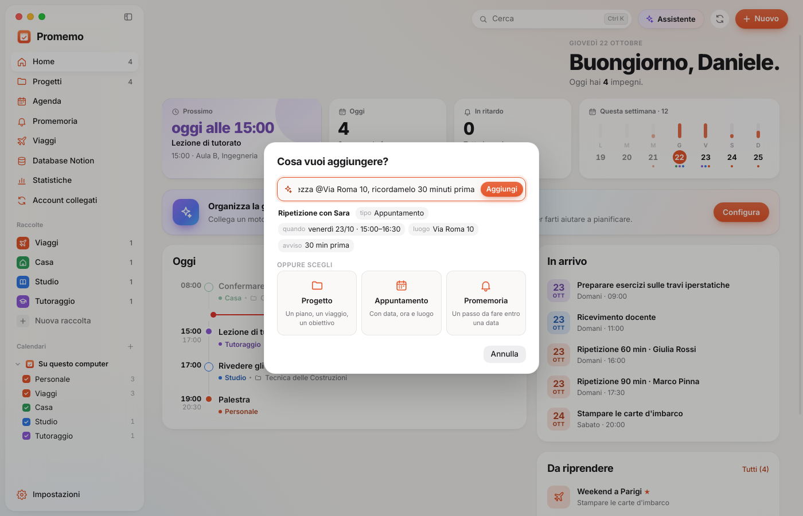 | 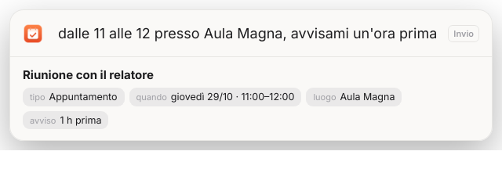 |

“ripetizione con Giulia giovedì alle 16 per un'ora, ricordamelo 30 minuti prima” diventa un appuntamento completo. Capisce date (oggi, domani, giovedì, il 3 novembre, 25/10, tra 2 giorni), orari (alle 9 e mezza, dalle 10 alle 12, stasera), durate, avvisi, luoghi (`@Via Roma 10`, “presso Aula Magna”), progetti (`#tecnica`), priorità (urgente) e compiti con scadenza (“studiare cap. 4 entro venerdì 2h”, pianificati da Promemo). Funziona nel pulsante *Nuovo*, nella palette (Ctrl+K), nel widget, sul telefono e nella **finestra rapida** (Ctrl+Alt+Spazio da qualsiasi app; su Wayland si collega il comando `promemo --aggiungi` a una scorciatoia di sistema).

## A che ora uscire
Per gli impegni con un luogo Promemo calcola il tragitto da casa, o dal luogo dell'impegno precedente nella stessa giornata, e mostra **“esci alle 15:20”** in agenda, nella Home e nel widget, con una notifica al momento giusto. A piedi sotto 1,3 km, altrimenti in auto (con margine per traffico e parcheggio), oppure il mezzo che scegli. Indirizzi e percorsi da OpenStreetMap; si configura in *Impostazioni → Spostamenti*.

## Riepilogo del mattino e della sera
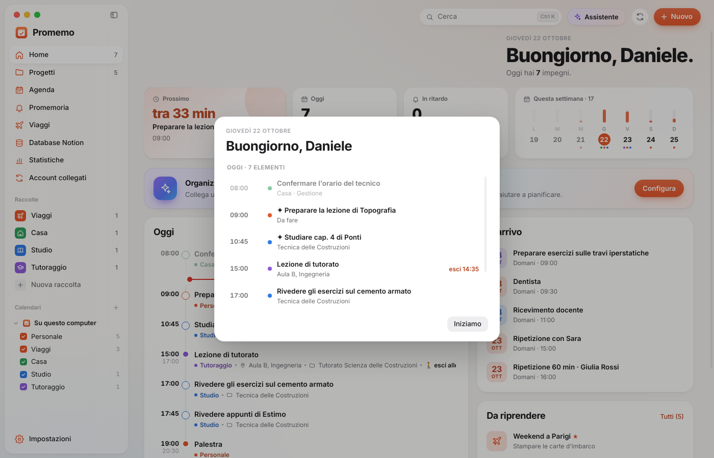

Alle 7:30 una notifica con la giornata: impegni, meteo, a che ora uscire, compiti in ritardo (da riportare a oggi o chiudere con un clic). Alle 21 cosa hai fatto, il tempo di concentrazione e cosa spostare a domani in un colpo solo. Orari in *Impostazioni → Notifiche*.

## Concentrazione
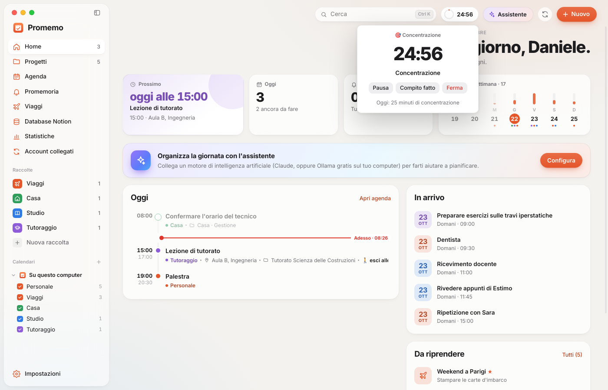

Timer a cicli (25 + 5 minuti, pausa lunga ogni 4) legato a un compito: si avvia da *Concentrati* nella scheda, dalla palette o dalle Statistiche, resta visibile in alto con un anello di avanzamento e registra il tempo dedicato a ogni progetto.

## Statistiche e pannelli
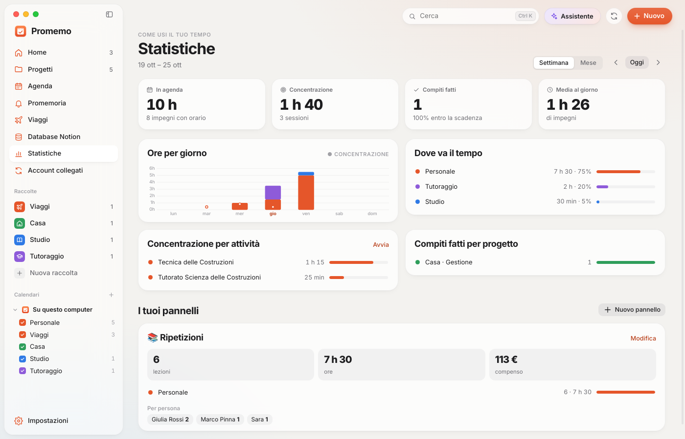

Ore in agenda per giorno e per calendario, concentrazione per attività, compiti fatti e puntualità, per settimana o mese. I **pannelli** sono tuoi: *Ore e compenso dall'agenda* (es. ripetizioni con tariffa oraria, conteggio per studente; ore di lezione per classe) e *Andamento da Notion* (es. carichi degli allenamenti nel tempo, una linea per esercizio).

## Widget e telefono
| Widget | Telefono |
|---|---|
| 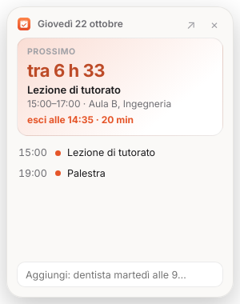 | 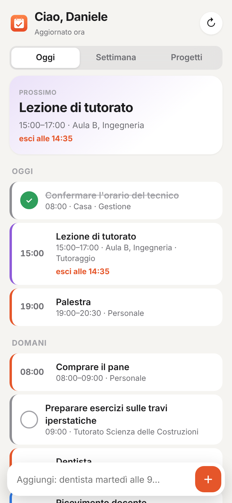 |

- **Widget sul desktop**: prossimo impegno con conto alla rovescia, “esci alle”, la giornata e un campo per aggiungere; sempre in primo piano, si sposta trascinandolo (anche dal menu dell'icona nell'area di notifica).
- **Telefono**: Promemo serve un'app web nella rete di casa. In *Impostazioni → Telefono* si attiva e si inquadra il codice QR; poi *Aggiungi a schermata Home*. Agenda di oggi e della settimana, compiti da spuntare, progetti, viaggi e aggiunta con una frase. Fuori casa funziona attraverso una VPN (es. WireGuard). L'accesso richiede la chiave del QR; il collegamento è HTTP, quindi va usato solo in rete locale o in VPN.

## App Android e sincronizzazione
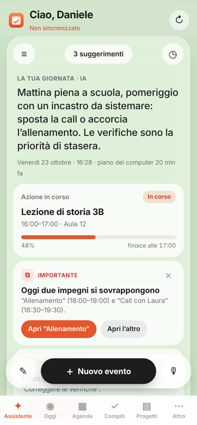

La prima schermata dell'app è l'**Assistente**: il riepilogo della giornata, l'impegno in corso con l'avanzamento (o il prossimo), i suggerimenti con le loro azioni e, in basso, il tasto **Nuovo evento** con il modulo completo, più ✎ per scrivere una frase e 🎙 per dettarla con il microfono della tastiera. Le regole girano anche sul telefono, sui dati appena sincronizzati; il piano scritto dall'IA, ciò che è stato trovato nella posta e lo storico arrivano dal computer. Le azioni fatte sul telefono tornano al computer con la sincronizzazione.

Il tasto 💬 apre **Chiedi**: scrivi o detta (🎙 usa il riconoscimento vocale di Android) cose come “cosa ho domani?”, “quando sono libero giovedì?”, “sposta la palestra a giovedì alle 19”, “trovami 2 ore per studiare idraulica entro venerdì”, “ho fatto gli esercizi”, “cancella la ripetizione di sabato” o una frase da aggiungere. Questi comandi funzionano anche senza rete, con *Annulla* dove serve. Le domande libere (“secondo te riesco a preparare l'esame?”) le passa all'IA del computer quando sei nella stessa rete.

| Oggi | Modifica |
|---|---|
| 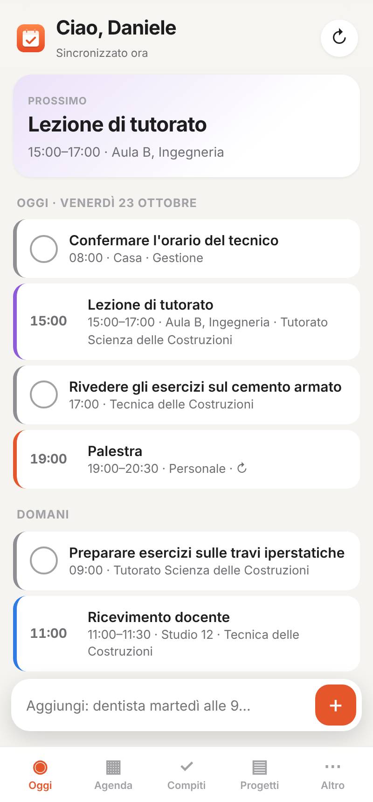 | 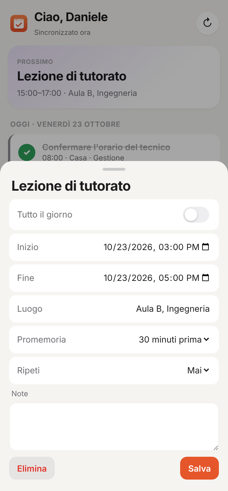 |

L'app per Android (file `Promemo-x.y.z.apk` tra gli allegati di ogni release) ha i dati sul telefono e funziona anche senza rete: **Oggi**, **Agenda** con i giorni a scorrimento, **Compiti** (in ritardo, oggi, prossimi), **Progetti** e **Viaggi**, modifica di eventi e compiti, ripetizioni, aggiunta con una frase e notifiche per i promemoria e per “esci alle” anche ad app chiusa.

La sincronizzazione è **bidirezionale**: ogni evento, compito, progetto e raccolta ha una data di modifica e le cancellazioni vengono annotate, così le modifiche fatte offline sui due dispositivi si uniscono (per lo stesso elemento vince la più recente). Gli eventi dei calendari collegati e i viaggi arrivano dal computer in sola lettura.

- **In rete** (o in VPN): il telefono parla direttamente con il computer, subito.
- **Fuori casa**: attraverso la stessa destinazione dei backup (Dropbox o WebDAV/Nextcloud), con file cifrati con la password dei backup (scrypt + AES-256-GCM). Il computer sincronizza all'avvio, dopo ogni modifica e periodicamente; il telefono all'apertura, dopo ogni modifica e ogni 2 minuti mentre è aperto.
- **Abbinamento**: *Impostazioni → Telefono*, attiva “Sincronizza con l'app Android” e inquadra il codice “App Android”; il telefono riceve anche l'accesso al cloud per quando è fuori casa.
- Prima di unire molte modifiche il computer salva una copia locale dei dati.

## Ripetizioni
Eventi e compiti possono ripetersi ogni giorno, nei giorni feriali, ogni settimana (scegliendo i giorni), ogni 2 settimane, ogni mese o ogni anno, fino a una data. Si impostano nel modulo dell'evento, nella scheda del compito o in una frase (“lezione di Topografia ogni martedì e giovedì alle 8 fino al 18 dicembre”). Una singola occorrenza si può saltare dalla scheda. Completato un compito ripetuto nasce il successivo. Le ripetizioni inviate a Google Calendar restano una sola serie.

## Annulla, cestino e copie
**Ctrl+Z** annulla l'ultima modifica e **Ctrl+Shift+Z** la ripete. Ciò che elimini resta nel **cestino** per 30 giorni (*Impostazioni → Cestino e copie*). Ogni giorno Promemo salva una **copia locale** dei dati (le ultime 14, cifrate se la password è attiva) e una prima di ogni ripristino o grande sincronizzazione.

## Registro degli errori
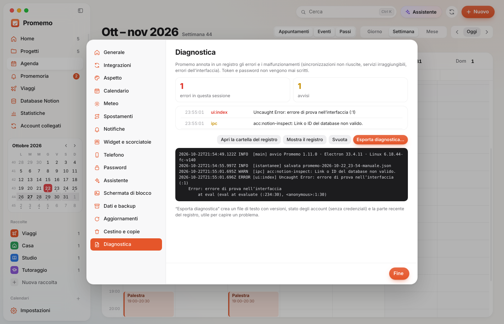

Errori e malfunzionamenti finiscono in `~/.config/Promemo/logs/promemo.log` (a rotazione, token e password mai scritti): sincronizzazioni non riuscite, servizi irraggiungibili, errori dell'interfaccia e delle finestre. *Impostazioni → Diagnostica* mostra gli ultimi problemi, il registro e permette di **esportare la diagnostica** (versioni, stato degli account senza credenziali, registro). Anche l'app Android ha il suo registro in *Altro*.

## Release automatiche
Il flusso GitHub Actions *Release* (a un nuovo tag `vX.Y.Z` o a mano indicando il tag) crea la release con le note di `docs/note/vX.Y.Z.md` e allega AppImage, .deb e l'APK Android firmato. Per firmare l'APK sempre con la stessa chiave servono due segreti del repository: `ANDROID_KEYSTORE_B64` e `ANDROID_KEYSTORE_PASS`.

## Aggiornamenti
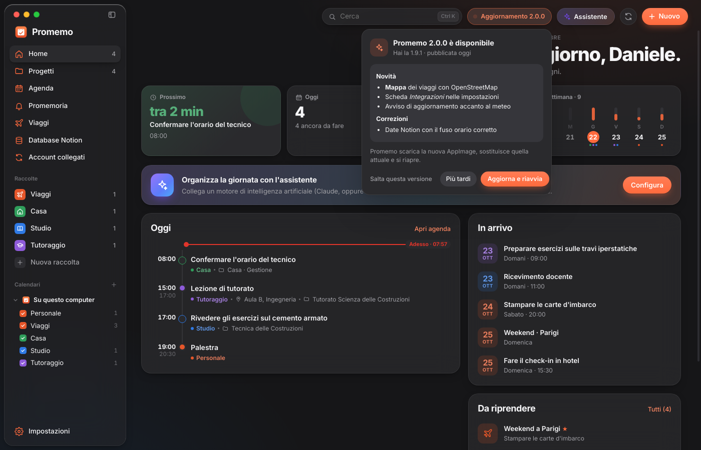

Promemo controlla le release pubblicate su GitHub all'avvio e ogni 6 ore. Quando esce una versione nuova, accanto al meteo compare un riquadro che lampeggia; un clic mostra le note di rilascio e:
- **AppImage**: *Aggiorna e riavvia* scarica la nuova AppImage, sostituisce quella attuale e riapre Promemo;
- **pacchetto .deb**: *Installa e riavvia* scarica il .deb e lo installa chiedendo la password del sistema;
- *Più tardi* ferma il lampeggio fino al prossimo avvio, *Salta questa versione* la nasconde.

Il controllo automatico si spegne in *Impostazioni → Aggiornamenti*. Perché funzioni, ogni release su GitHub deve avere un tag di versione (es. `v1.12.0`) e i file `Promemo-x.y.z.AppImage` e `promemo_x.y.z_amd64.deb` allegati; il testo della release diventa la nota mostrata nell'app.

## Integrazioni
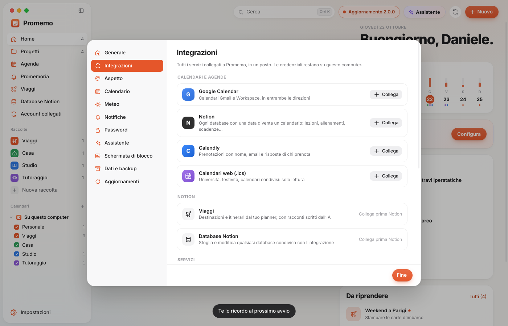

*Impostazioni → Integrazioni* raccoglie tutti i servizi collegati: Google Calendar, Outlook e Microsoft 365, iCloud e i server CalDAV, Notion (anche più database), Todoist, Calendly, Cal.com e calendari web con stato, ultima sincronizzazione, pausa e sincronizzazione manuale per ogni account; Viaggi e Database Notion; assistente IA, meteo, backup nel cloud e aggiornamenti; frequenza della sincronizzazione (da 5 a 60 minuti, senza riavviare).

## Viaggi
Promemo legge da Notion i dati essenziali di ogni viaggio e l'intelligenza artificiale scrive il resto.

| Itinerario | Mappa | Viaggi |
|---|---|---|
| 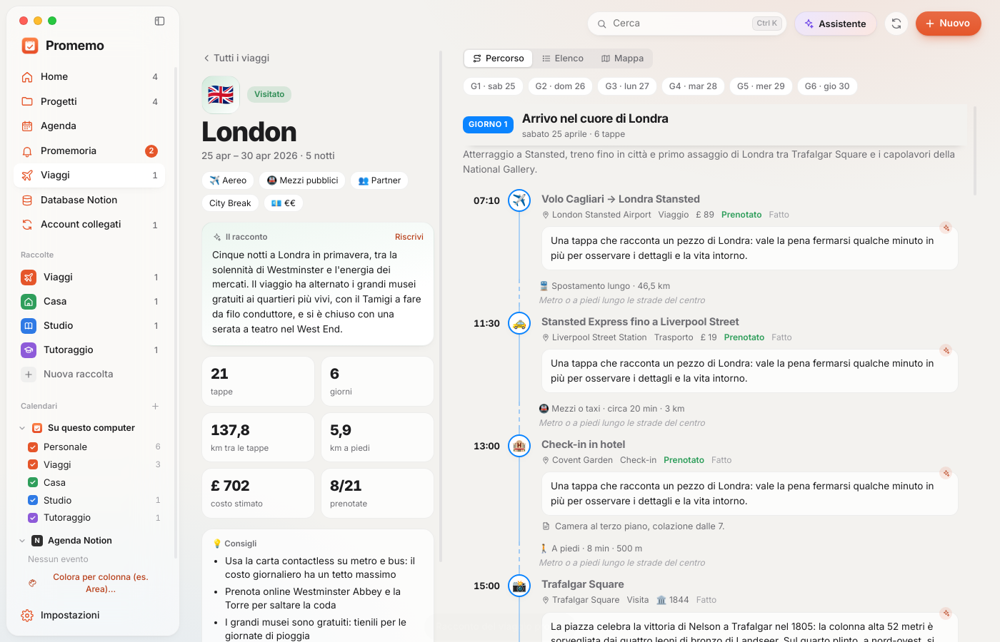 | 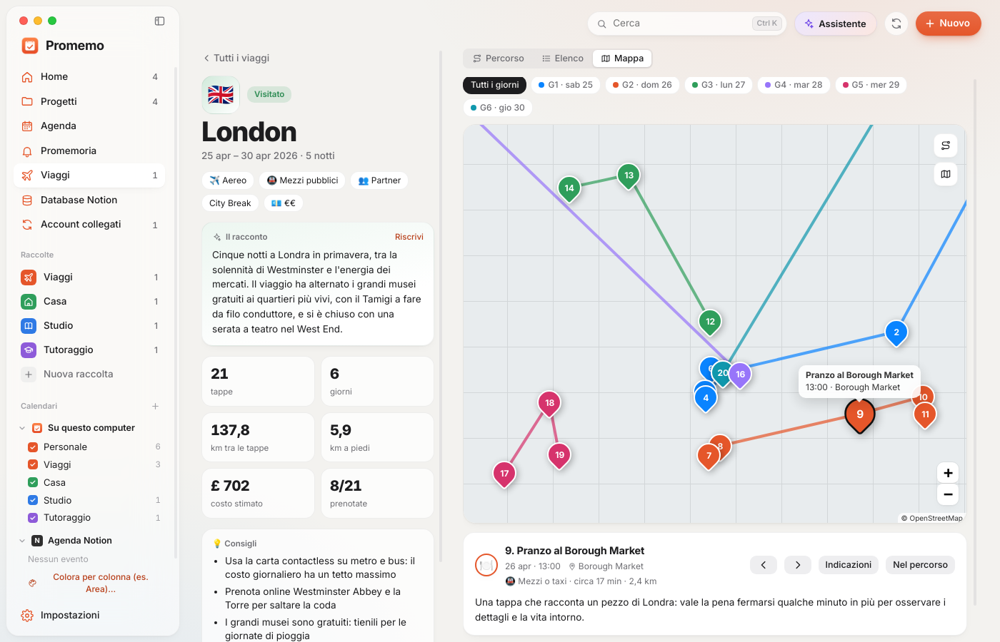 | 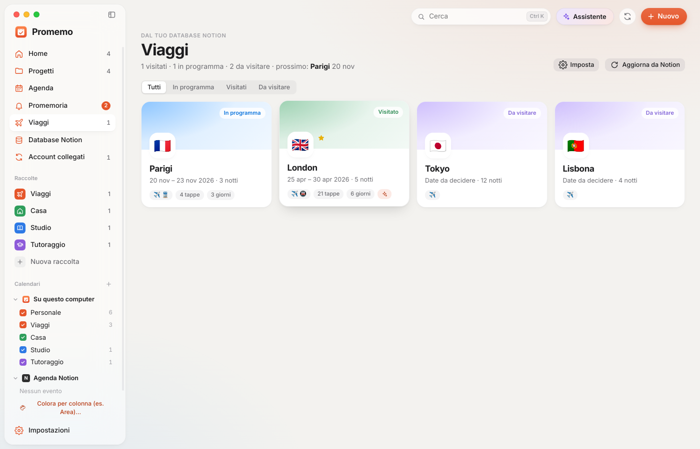 |

- **Da Notion**: si sceglie il database delle destinazioni (es. *Destinations* del Travel Planner). Le colonne vengono riconosciute da sole: nome, stato (*Visited / In Planning / Want to go*), date, notti, mezzi di trasporto, compagni di viaggio, budget, preferito. L'**itinerario** è il database annidato nella pagina del viaggio, trovato anche dentro colonne e toggle: per ogni tappa attività, data e ora, **luogo** (colonna di tipo posizione, con coordinate), tipo, stato, prenotato, costo stimato, note, *Storia*, *Da cercare*, *Anno storico*.
- **Dall'IA** (*Scrivi con l'IA* nella pagina del viaggio): il racconto del viaggio, un titolo e una sintesi per ogni giorno, la storia e le curiosità di ogni luogo, come spostarsi da una tappa all'altra e qualche consiglio pratico. Se in Notion la colonna *Storia* è già compilata, vince quella. Per un viaggio già fatto i testi sono scritti come un ricordo. I testi restano salvati sul computer e si possono riscrivere.
- **Percorso**: linea del tempo per giorno con orari, tipo di tappa e distanza e tempo a piedi o con i mezzi tra una tappa e l'altra (calcolati dalle coordinate). **Elenco**: tabella compatta. **Mappa**: una mappa vera (strade e quartieri da OpenStreetMap, stile chiaro o scuro con il tema) con le tappe numerate e collegate per giorno; zoom, trascinamento, filtro per giorno, frecce per passare da una tappa all'altra, *Indicazioni* che apre il navigatore. All'apertura inquadra il centro senza farsi rimpicciolire da aeroporti e gite fuori città (un pulsante mostra anche quelli). Nel Percorso un clic sul luogo di una tappa la apre sulla mappa. Serve la connessione per lo sfondo; le tappe restano visibili anche offline.
- **In Agenda**: il viaggio compare come evento di più giorni e ogni tappa con orario come appuntamento nel gruppo *Viaggi da Notion* (colore e visibilità dalla barra laterale). Un clic su una tappa apre l'itinerario in quel punto.
- I viaggi si aggiornano con la sincronizzazione periodica o con *Aggiorna da Notion*.

## Servizi collegabili
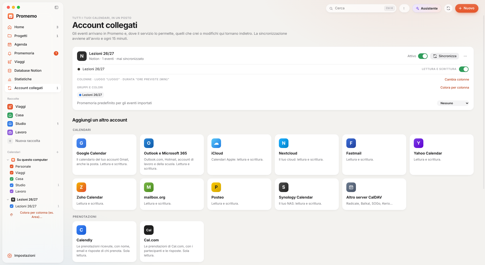

In *Account collegati → Aggiungi un altro account*:
- **Calendari, nei due sensi**: Google Calendar; **Outlook e Microsoft 365** (Outlook.com, Hotmail, account di lavoro e della scuola: serve un ID applicazione gratuito da Microsoft Entra, le istruzioni sono nella finestra); **iCloud**, **Nextcloud**, **Fastmail**, **Yahoo**, **Zoho**, **mailbox.org**, **Posteo**, **Synology** e qualsiasi server **CalDAV** (Radicale, Baïkal, SOGo…), con utente e password per app. Gli eventi che si ripetono, creati in quei servizi, sono in sola lettura e si modificano lì.
- **Prenotazioni**: Calendly e **Cal.com** (sola lettura, con i partecipanti e la scheda dello studente).
- **Compiti e database**: Notion e **Todoist** (ogni progetto di Todoist diventa un progetto di Promemo; nuovi compiti, fatti, date e priorità nei due sensi).
- **Da un link .ics** (sola lettura): calendari pubblici, **Proton Calendar**, **Airbnb, Booking e Vrbo**, orari universitari e scolastici.

## Database Notion
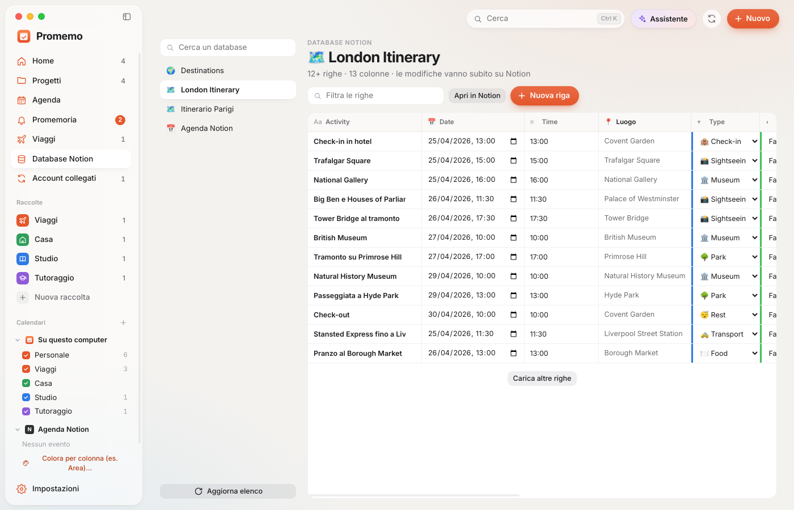

Tutti i database condivisi con l'integrazione (lezioni, allenamenti, scadenze, letture…), in tabella: titolo, testo, numeri, selezione, stato, selezione multipla, caselle, date, link, email e telefono si modificano direttamente e la modifica va subito su Notion. Ordinamento per colonna, filtro, nuove righe, archiviazione (doppio clic sul cestino) e collegamento alla pagina in Notion. Le altre colonne (posizione, relazioni, formule, rollup, persone, file) sono in sola lettura.

Ogni database con una colonna data può comparire anche in **Agenda** con *Mostra in Agenda*: diventa un calendario sincronizzato in entrambe le direzioni, con i colori presi da una colonna Seleziona o Stato (es. la classe o il tipo di allenamento). Il token dell'integrazione già salvato si riusa, quindi basta scegliere il database.

Le colonne si riconoscono dal nome: **Luogo** (anche di tipo *Luogo* di Notion), la **durata** (“Ore previste (min)”, “Durata”…) che diventa la fine dell'evento quando la data non ne ha una, e tutte le altre colonne (argomento, materia, docente, relazioni e rollup con i nomi delle pagine collegate) che compaiono nella scheda dell'evento sotto *Dal database*. *Cambia colonne* nella scheda dell'account permette di sceglierle a mano e di nascondere quelle che non servono.

## Meteo
Icona in alto a destra con la temperatura attuale; un clic apre condizioni, umidità, vento, alba e tramonto, le prossime 24 ore e i 7 giorni. Nella Home c'è un riquadro con la situazione di oggi e nelle viste Giorno/Settimana ogni giorno mostra icona e massima. La località si cambia in *Impostazioni → Meteo* (predefinita: Cagliari). Dati di [Open-Meteo](https://open-meteo.com), gratuiti e senza account.

## Scheda del compito (Agenda)
Un clic su un compito o su un evento, nelle viste Giorno, Settimana o Mese, apre a destra una scheda con:
- **compito**: titolo modificabile, fatto/da fare, progetto e raccolta, scadenza, durata stimata (determina l'altezza del blocco nella settimana), promemoria, priorità, **sotto-attività** con barra di avanzamento, **note** con salvataggio automatico (si possono copiare nella timeline del progetto) e gli altri passi del progetto;
- **evento**: orario, luogo (con link se è online), calendario, progetto, promemoria, partecipanti (da Calendly), descrizione e **appunti personali** che restano solo sul computer e non vengono inviati a Google/Notion.

## Backup e sincronizzazione tra computer
*Impostazioni → Dati e backup*. I backup sono file `.pmbak` **cifrati** (AES-256-GCM, chiave derivata con scrypt da una password dei backup) e non contengono mai token o password degli account.

| Destinazione | Servizi |
|---|---|
| Cartella sincronizzata | MEGA (MEGA Desktop), Dropbox, Nextcloud, ownCloud, Google Drive, OneDrive, pCloud, Syncthing… (cartelle rilevate in automatico) |
| Dropbox diretto | API Dropbox con una tua *App key* (accesso “App folder”, collegamento con codice PKCE) |
| WebDAV | Nextcloud, ownCloud, Koofr, kDrive, Box, NAS |
| rclone | MEGA, Google Drive, OneDrive, pCloud, Proton Drive, S3 e altri ~70 servizi |

- Frequenza: dopo le modifiche (con attesa regolabile e sempre alla chiusura), una volta al giorno o solo a mano; versioni conservate a scelta.
- **Ripristino** da elenco delle versioni o da file; prima di sostituire i dati viene salvata una copia di sicurezza locale. Account collegati, password e impostazioni dei backup restano quelli del computer.
- **Sincronizza tra computer**: se un altro PC ha salvato una versione più recente nella stessa destinazione, compare un avviso con *Aggiorna*/*Ignora*.

## Assistente (IA)
Motori disponibili: **modello installato sul computer** (Promemo trova da solo LM Studio, Ollama, Jan, llama.cpp, LocalAI, vLLM, GPT4All, KoboldCpp e text-generation-webui e ti fa scegliere il modello: gratis e senza inviare niente in rete), Ollama, Claude e servizi compatibili OpenAI. Le conversazioni restano salvate: l'icona dell'orologio nella finestra dell'assistente apre la cronologia per riaprirle, continuarle o eliminarle.

Nella Home e con il pulsante **Assistente** (Ctrl+J) si apre una conversazione che organizza la giornata di oggi o di domani:
1. l'assistente legge impegni del giorno, passi in ritardo e scadenze vicine;
2. fa fino a 4 domande una alla volta (priorità, quando ti concentri meglio, vincoli, quanto riempire la giornata), con risposte rapide da cliccare;
3. propone un piano a blocchi (impegni fissi, lavoro/studio, passi, pause, pasti, spostamenti) che puoi correggere scrivendo (“più pause”, “finisci alle 18”);
4. **Aggiungi all'agenda** crea i blocchi come eventi (con promemoria a scelta); si possono sostituire o rimuovere.

Motori supportati (*Impostazioni → Assistente*):
| Motore | Costo | Privacy |
|---|---|---|
| Claude (API Anthropic) — `claude-sonnet-5-5`, `claude-haiku-5-5`, `claude-opus-5-5` | a consumo, qualche centesimo a pianificazione | impegni del giorno inviati ad Anthropic |
| Ollama sul computer (es. `llama3.1`) | gratis | tutto resta in locale |
| Compatibile OpenAI (OpenAI, LM Studio, Groq, OpenRouter…) | dipende dal servizio | dipende dal servizio |

La chiave API è salvata cifrata insieme alle altre credenziali.

## Barra laterale
Il pulsante in alto a sinistra (o Ctrl+B) riduce la barra a sole icone: Home, Progetti, Agenda, Promemoria, Account collegati e Impostazioni, con i contatori come pallini. Sotto i 1060 px di larghezza si riduce da sola.

## Impostazioni
Finestra a sezioni: **Generale**, **Aspetto** (tema e colore principale), **Calendario** (vista predefinita, inizio giornata, fine settimana), **Notifiche**, **Password**, **Schermata di blocco**, **Dati e backup**.

### Schermata di blocco su misura
Anteprima dal vivo e a schermo intero. Si possono scegliere:
- sfondo *Aurora* (6 tavolozze o 3 colori a scelta, con movimento lento), *Tinta unita* o *Immagine* (con sfocatura e oscuramento);
- orologio (sì/no, 4 spessori, dimensione), data;
- titolo e sottotitolo (es. “Bentornato, Daniele”), icona, suggerimento della password;
- riquadro *Vetro*, *Pieno* o *Minimale* e colore del testo.

Queste preferenze sono salvate in chiaro in `promemo.lockscreen.json`, perché servono prima dello sblocco.

## Calendari annidati nella barra laterale
Trascina una voce dei calendari (o un intero account, come un database di Notion) sopra un'altra voce, per esempio *Lezioni 26/27* dentro *Lavoro*: la voce che contiene altre voci prende una freccia per aprirle e chiuderle, e la sua casella mostra o nasconde tutto quello che contiene. Per toglierla, passa sopra la voce e premi ↰, oppure trascinala su *Su questo computer*. Funziona con qualsiasi voce e su più livelli.

In *Impostazioni → Generale* puoi togliere dalla barra laterale Viaggi, Database Notion e Statistiche (restano raggiungibili con Ctrl+K).

## Calendari e colori
Nella barra laterale, sotto **Calendari**, ogni account mostra i suoi gruppi con un colore:
- **Su questo computer**: *Personale* e una voce per ogni raccolta (Viaggi, Casa, Studio…).
- **Google**: un gruppo per ogni calendario sincronizzato.
- **Notion**: un gruppo per ogni valore di una colonna *Seleziona*, *Selezione multipla* o *Stato* (es. `Area`: Personale, Lavoro, Università…). I colori di partenza sono quelli di Notion.
- **Calendari .ics**: un gruppo per calendario, più uno per ogni `CATEGORIES` presente.

Clic sul quadratino = mostra/nascondi. Icona tavolozza = scegli il colore: 9 famiglie con 4–5 sfumature (es. Personale in rosso, tutto il lavoro in varianti di azzurro) o un colore personalizzato. Schede, punti del calendario e popup usano il colore del gruppo.

## Sincronizzazione
| Servizio | Direzione | Cosa serve |
|---|---|---|
| Google Calendar (Gmail) | lettura e scrittura | un ID client OAuth di tipo *App desktop* (istruzioni nell'app) |
| Notion | lettura e scrittura | token di un'integrazione interna + database con una proprietà Data condiviso con l'integrazione |
| Calendly | sola lettura | un token di accesso personale (funziona anche con il piano gratuito) |
| Link .ics / webcal (iCloud, Outlook, Nextcloud, Proton, orari corsi…) | sola lettura | l'indirizzo iCal pubblico o segreto |

- **Calendly**: ogni prenotazione arriva con nome ed email di chi prenota, risposte al modulo, luogo o link della videochiamata e link per spostare/annullare. I tipi di appuntamento (es. *Ripetizione 60 min*) diventano gruppi colore. Le copie che Calendly scrive nel calendario Google collegato vengono nascoste per evitare doppioni (disattivabile).
- Avviene all'avvio, ogni 15 minuti, al risveglio del PC e con il pulsante ⟳ in alto.
- Gli eventi creati in Promemo possono andare su Google o Notion (campo *Calendario*); modifiche ed eliminazioni vengono inviate al servizio.
- Gli eventi importati restano collegabili a un progetto e possono avere un promemoria di Promemo.
- Finestra sincronizzata: da 60 giorni fa a circa 13 mesi avanti.
- Token e credenziali sono in `~/.config/Promemo/credenziali.bin`, cifrati con il portachiavi di sistema (GNOME Keyring/KWallet) quando disponibile.

## Avvio (sviluppo)
```bash
npm install
npm start
```

## Pacchetti
```bash
npm run dist        # dist/Promemo-1.12.0.AppImage e dist/promemo_1.12.0_amd64.deb
sudo apt install ./dist/promemo_1.12.0_amd64.deb
```

## Scorciatoie
In Agenda: scorrimento a due dita sul touchpad (o ← →) per andare avanti e indietro, T per tornare a oggi · Ctrl+Z annulla · Ctrl+Shift+Z ripeti · Ctrl+Alt+Spazio aggiunta rapida (da qualsiasi app) · Ctrl+K palette comandi e frasi · Ctrl+J assistente · Ctrl+B barra laterale · Ctrl+N nuovo · Ctrl+F cerca · Ctrl+1…5 sezioni principali · Esc chiude popup e finestre.

## Dati
`~/.config/Promemo/promemo.json` (scrittura atomica). Backup da *Impostazioni → Esporta*.


## Struttura
```
main.js        processo principale: archivio, promemoria, vassoio, IPC
backup.js      backup cifrati e destinazioni (cartella, Dropbox, WebDAV, rclone)
ai.js          motori IA (Anthropic, Ollama, compatibili OpenAI)
vault.js       cifratura locale (scrypt + AES-256-GCM, chiave di recupero)
quick.js       creazione da una frase (finestra rapida, widget, telefono)
travel.js      tempo di viaggio (Nominatim, routing OSM)
mobile.js      server per il telefono e abbinamento con QR
phonesync.js   sincronizzazione con l'app Android (rete e cloud cifrato)
agent.js       assistente proattivo: letture periodiche, piano IA, notifiche, azioni, domande dal telefono
mail.js        lettura della posta (Gmail): inviti e, con l'IA, impegni e scadenze
providers2.js  CalDAV (iCloud, Nextcloud…), Outlook / Microsoft 365, Cal.com, Todoist
log.js         registro degli errori e diagnostica
mobile-app/    app Android (Capacitor) con dati locali, notifiche e sincronizzazione
updater.js     aggiornamenti dalle release di GitHub (AppImage e .deb)
notiondb.js    database Notion: elenco, schema, righe, modifica; itinerari annidati
sync.js        Google Calendar (OAuth PKCE), Notion API, feed .ics; unione e invio modifiche
ics.js         parser iCalendar con fusi orari e ricorrenze
preload.js     ponte sicuro verso l'interfaccia
src/nlp.js     interpretazione delle frasi in italiano (condiviso)
src/recur.js   ripetizioni (condiviso)
src/syncmodel.js modello di sincronizzazione (condiviso con l'app Android)
src/agentrules.js cosa nota l'assistente e cosa propone (condiviso con l'app Android)
src/studyplan.js piano di studio verso un esame (condiviso)
src/           interfaccia (HTML, CSS, JS senza framework; Leaflet in src/vendor per le mappe)
```

## Licenza
MIT
